# Repairing Timestral-5M by editing 6,144 weights by hand

Timestral-5M, a small time-series forecasting model by Mistral, forgets repeating patterns
once it forecasts more than about 500 steps ahead. We traced the failure to **one attention
head**, and an LLM agent repaired it by editing the model's weights directly: **no training,
no gradients**, only reasoning about what the weights do. The edit changes 6,144 weights
(0.12 % of the model), brings the lost patterns back, cuts the distant-forecast error on real
cyclic data (by 22-54 % on real ocean tides from four gauges), and leaves a 97-task public
benchmark unchanged.

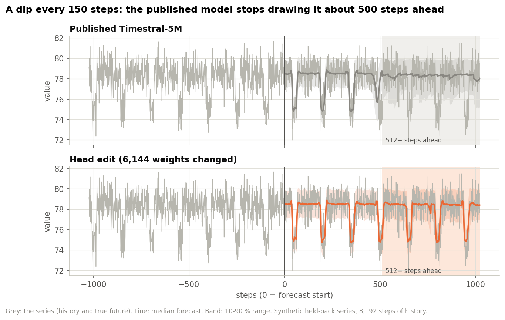

### How we measure

Two measures are used throughout:

- **Dip score: how much of a repeating dip the forecast draws.** For each dip in the true
  future, we compare the forecast's level inside the dip with its level just before and after,
  and divide by the true depth of the dip.
  - **1** (or 100 %): the full dip is drawn, at the right place.
  - **0**: no dip at all, a flat line.
  - **Negative**: the forecast draws the opposite where the dip should be (a bump, or a dip
    shifted to the wrong place).

  We average it over every dip that starts **512 or more steps ahead** ("distant dips") or
  less than 384 steps ahead ("near dips").
- **Error ratio: the edited model's error divided by the published model's,** on the same
  forecasts.
  - **1.00**: same error.
  - **0.90**: 10 % less error.
  - **1.10**: 10 % more.

  The error is MASE, the standard benchmark measure: forecast error relative to a simple
  "repeat the last cycle" forecast. Over many tasks we average the ratios (geometric mean).

### Results at a glance

| | Published Timestral-5M | With the head edit |
| --- | --- | --- |
| Distant dips drawn (512+ steps ahead, fresh synthetic series no model saw) | **none** (−2 %) | **82 %** of each dip |
| Error on the distant part (512+ steps ahead) of real forecasts, 15 real tasks whose series repeat a cycle | reference | **10 % less on average**, up to 44 % less |
| Error on real server-monitoring data (`bizitobs_service`, 100-minute forecasts) | reference | **12.5 % less** (ratio 0.875) |
| Error 2-4 days ahead on real ocean tides (4 NOAA gauges, outside the benchmark) | reference | **22-54 % less**, better in 88-100 of 100 forecasts per gauge |
| Error on GIFT-Eval, 97 real forecasting tasks | reference | **unchanged** (ratio 0.999) |
| Weights changed | — | 6,144 of 5,208,960 (0.12 %) |

---

## Key findings

### 1. Timestral-5M loses repeating patterns about 500 steps ahead; larger models don't

Give the model a series with a dip every 180 steps and ask for 1,024 steps. We score each
future dip by the share of its depth the forecast draws (1 = the full dip, 0 = none). The 5M
model draws the near dips, then nothing from about 500 steps ahead. The 28M model holds a bit
longer; 123M holds to the end.

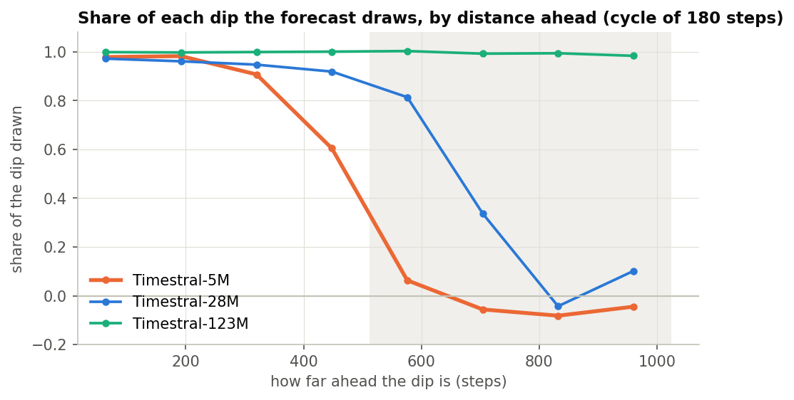

The failure only appears when the cycle is **not a whole number of 32-step patches**: a dip
every 96 steps (3 patches) is drawn all the way, a dip every 80 steps (2.5 patches) vanishes
from patch 12 on. It also shows on real data: on GIFT-Eval's `bizitobs_service` (server
metrics every 10 seconds, one-hour cycle), 5M was 24 % worse than 28M, and the gap sat
480-576 steps into the forecast, where the second dip of the cycle falls.

### 2. The cause is one attention head that always looks 11 patches back

The model forecasts in **blocks of 32 future patches**. Head 5.1 (layer 5, head 1) ignores
content and always reads the token exactly **11 patches back**. The heads after it (6.1, 6.2,
7.x) use what it brings to find the matching place in the history and copy the pattern. For a
future patch more than 11 positions into the block, "11 back" is **another future patch,
which holds no data yet**, so the match fails and the pattern is lost.

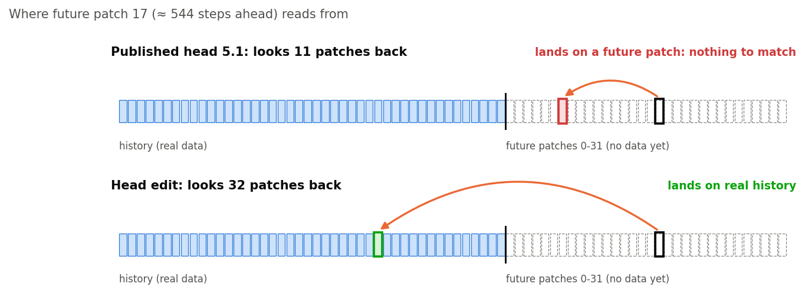

Four measurements located it (detailed in [How we found the head](#how-we-found-the-head)):
head 5.1 puts 91 % of its attention exactly 11 back; switching it off costs more than any
other head; swapping internal states shows the information is lost in layer 5; and forcing
the head to read 32 back brings the far dips back (68 % and 91 % of each dip drawn, instead of
none).

### 3. Editing that one head by hand repairs the failure

An agent (Claude Code running Claude Fable 5.2), allowed only to read the weights and change them by reasoning (no
gradients, no training, 200 counted model runs on two diagnostic series), rewrote the query
weights of head 5.1 so it looks **32 patches back**: the shortest distance that lands on
real history from every position in a block. The edit touches the 32 rotary-position rows of
the head's query, **6,144 weights**. On fresh series it never saw, the edited model draws
82 % of each distant dip, against none before (top figure). We call this change **the head
edit** (the files name it `edit_b`).

### 4. It matches or beats fine-tuning, without the collateral damage

We compared the hand edit with two gradient-based fixes trained on series that show the
failure: a **full fine-tune** (all 5.2 million weights) and a **fine-tune of only the same
6,144 weights** the agent chose. All three are scored on the same unseen data.

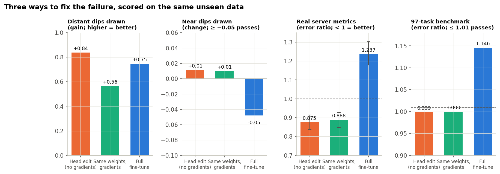

| | Head edit (no gradients) | Same 6,144 weights, gradients | Full fine-tune |
| --- | --- | --- | --- |
| Distant dips drawn (published: none, −2 %) | **82 %** of each dip | 55 % | 73 % |
| Near dips drawn (published: 88 %) | 89 % | 89 % | 83 % |
| Error on real server metrics, vs published (95 % interval) | **12.5 % less** (8.6-16.3 % less) | 11 % less (7-15 % less) | 24 % more (18-30 % more) |
| Error on the 97-task benchmark, vs published | unchanged (0.999) | unchanged (1.000) | 15 % more (1.146) |

The chart shows the same numbers as changes from the published model (dip-score gains, error
ratios).

- **The full fine-tune** repairs the dips but damages everything around them: 24 % more error
  on the server data, worse by more than 5 % on 67 of the 97 benchmark tasks.
- **Training only the weights the agent chose** is as safe as the hand edit, but repairs
  less (55 % of each distant dip against 82 %).
- So **knowing where to edit is what avoids the damage**, and the agent's hand-chosen values
  got the most out of that location.

> **How the fine-tunes were trained.** Both use the same recipe; only the set of trainable
> weights differs.
>
> - **Data:** synthetic series made fresh at every step, from the same family as the failure
>   (a level with noise and one dip repeating every *c* steps). Each batch holds 32 series:
>   8 cycle lengths *c* drawn from 40 to 400 steps, 4 series each. The comparison above is
>   scored on new series none of the models saw; two of its seven cycle lengths (64 and 70)
>   were never trained on, the other five (100, 150, 160, 220, 300) were in the training range.
> - **Task:** 8,192 steps of history, a 1,024-step forecast in one pass, run through the
>   model's own forecasting code, so training sees exactly what inference does.
> - **Loss:** the quantile (pinball) loss over the model's 21 quantiles and the whole horizon.
> - **Settings:** AdamW, 600 steps, gradient clipping at 1.0, no weight decay.
>   - **Full fine-tune:** every weight is trained, learning rate 1e-4.
>   - **Restricted fine-tune:** only the 6,144 weights the head edit changed are trained (32 rows of
>     the query of head 5.1); every other weight is frozen, and the script checks afterwards
>     that nothing else moved. Three learning rates were tried (1e-4, 1e-3, 1e-2). The rule,
>     fixed before training, picked the best distant-dip score among those that keep near
>     dips within 0.05 of the published model: 1e-3.
>
> Scripts: `experiments/edit_5m/baseline_finetune.py` (mode `anycycle`) and
> `finetune_same_weights.py`.

### 5. On real data the gain sits exactly where the failure lives: far ahead

[GIFT-Eval](https://github.com/SalesforceAIResearch/gift-eval) is a public benchmark of 97
real forecasting tasks (electricity, solar, traffic, weather, server monitoring, sales,
births, …) at sampling rates from 10 seconds to a year, each forecast at short, medium and
long range. Overall, the head edit changes nothing (0.999). Domain by domain it is at most 1 % worse
anywhere and 3 % better on the web / cloud-operations data; the full fine-tune is worse in
every domain.

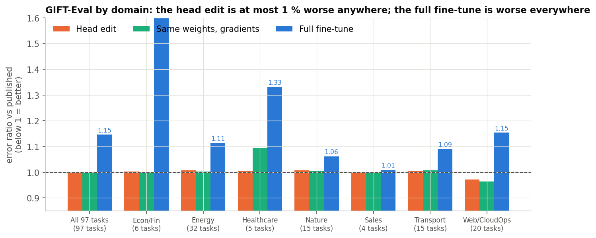

Splitting the 23 long-range tasks into the near part of the forecast (0-383 steps ahead) and
the distant part (512+ steps) shows where the gain comes from. On the 15 tasks whose series
have a strong cycle that is not a whole number of patches, the head edit cuts the **distant-part
error by 10 % on average, and by up to 44 %**, while the near part gets 3 % worse. Elsewhere it
changes nothing.

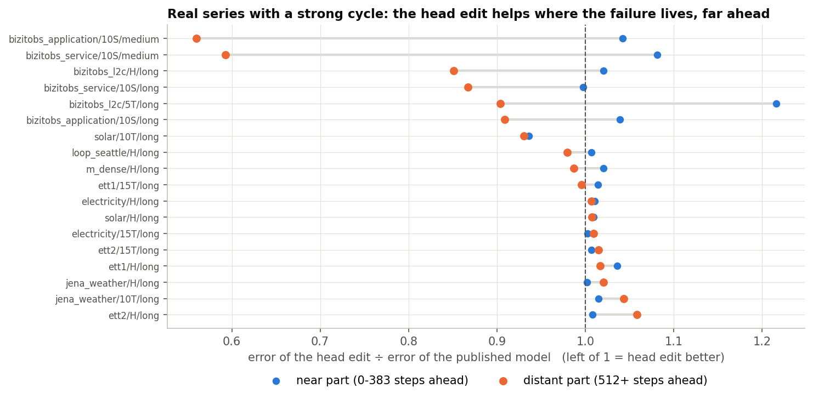

**On the benchmark's server data, step by step.** Forecast error averaged over **every** window
of the 10-second server tasks, by distance ahead (no window picked):

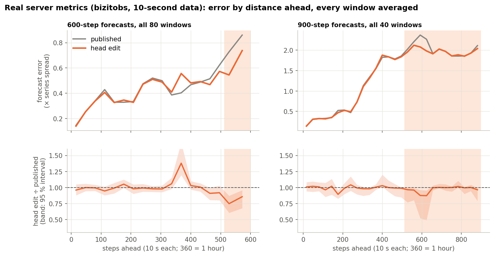

- **600-step forecasts (left, 80 windows).** The two models make the same errors for the first
  ~450 steps; then the head edit's error stays lower: **19 % less over the distant part** (512+ steps),
  with the 95 % interval clear of "no change". There is also a cost: around 350-400 steps
  ahead the head edit is worse (up to 38 % more error), where it sometimes draws a dip that isn't
  there.
- **900-step forecasts (right, 40 windows).** The gain is concentrated at 560-640 steps ahead
  (about 12 % less error), where the next hourly dip falls; over the whole distant part it is
  3 % less.

On these noisy server series, the edit helps where the next cycle's dip falls far ahead: real
but local, with a small cost earlier in the forecast.

### 6. On real ocean tides, outside the benchmark, the failure and the fix are as clear as on synthetic data

To test the edit on data that was not part of any benchmark we had used, we took a series with
the failure's ingredients: a regular repeating pattern whose period is not a whole number of
patches. Ocean tides are exactly that: water level every 6 minutes from a NOAA tide gauge in
Seattle (January to March 2024, public data); the main tide repeats every 12.42 hours, which is
124.2 steps, or 3.9 patches. We forecast 1,024 steps (≈ 4 days) from 8,192 steps of history, at
100 start points.

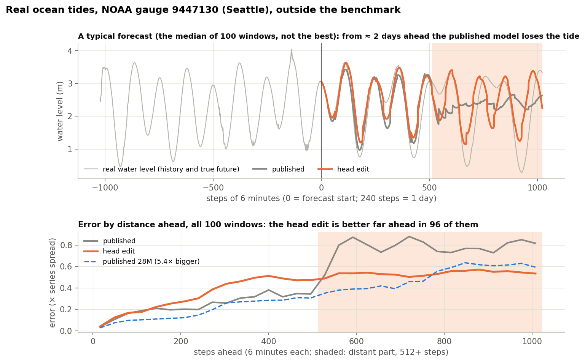

- **Top, a typical forecast** (the window with the median improvement, not the best): both
  models follow the tide for about 2 days. Then the published model loses it and draws a flat,
  jittery line; the head edit keeps the tide's rhythm to the end of the forecast.
- **Bottom, all 100 forecasts:** the published model's error **jumps at about 512 steps ahead**,
  exactly where the mechanism says the failure starts, and stays high. The head edit's error stays flat.
  Over the distant part the head edit has **31 % less error**, and it is better far ahead in **96 of
  the 100** forecasts.
- **The cost, visible here too:** between about 200 and 500 steps ahead, the head edit's error is
  higher than the published model's.

**More real series, same protocol.** Three more tide gauges (The Battery in New York, Boston,
Honolulu), solar radiation every 10 minutes at three German Weather Service stations (zero every
night, a daily cycle of 144 steps = 4.5 patches), and NYC taxi demand (passengers every 30
minutes, a deep dip every night). For each: 100 forecasts (18 for the shorter taxi series) on a
gap-free stretch.

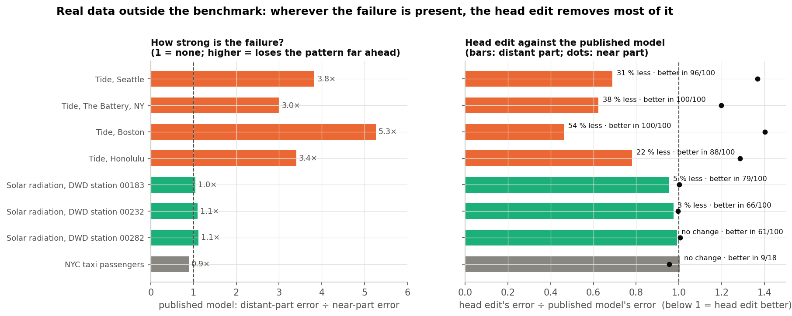

| Series | Failure: published distant error ÷ near error | Head edit, distant error | Head edit better far ahead | Head edit, near error |
| --- | --- | --- | --- | --- |
| Tide, Seattle | 3.8× | **31 % less** | 96 / 100 | 37 % more |
| Tide, The Battery, NY | 3.0× | **38 % less** | 100 / 100 | 20 % more |
| Tide, Boston | 5.3× | **54 % less** | 100 / 100 | 40 % more |
| Tide, Honolulu | 3.4× | **22 % less** | 88 / 100 | 29 % more |
| Solar radiation, 3 stations | 1.0-1.1× (barely any) | 1-5 % less | 61-79 / 100 | unchanged |
| NYC taxi | 0.9× (none) | no change | 9 / 18 | 4 % less |

- **Wherever the failure is present** (all four tide gauges, from 3× to 5×), the head edit removes most
  of it: 22-54 % less distant error, better in 88 to 100 of every 100 forecasts.
- **Where it is absent** (solar radiation, taxi), the head edit is harmless: the two forecasts overlap.
  These series are regular too, but the published model already extrapolates them well.
- **The cost is consistent on tides:** the near part of the forecast (first ≈ 1.5 days) is 20-40 %
  worse. It is the same trade-off as on the server data and in finding 9.

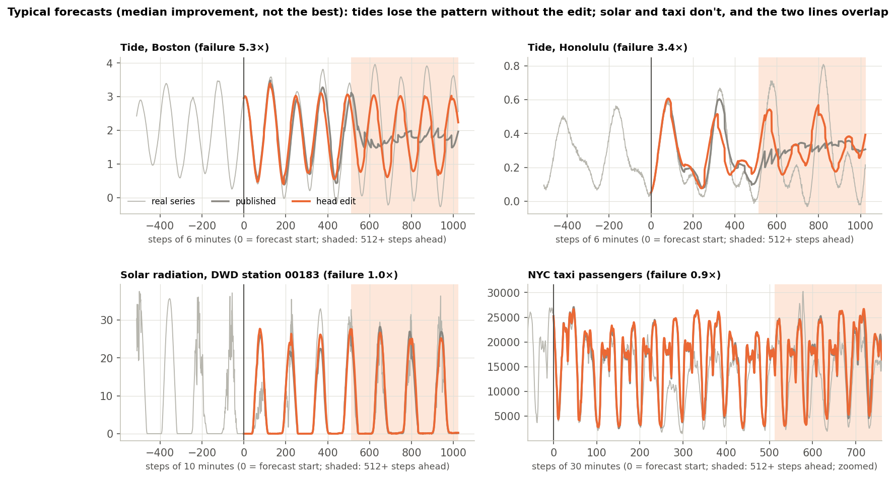

**Against the larger published models.** On the same tide forecasts we also ran the published
28M (5.4× more weights) and 123M models, which barely have the failure.

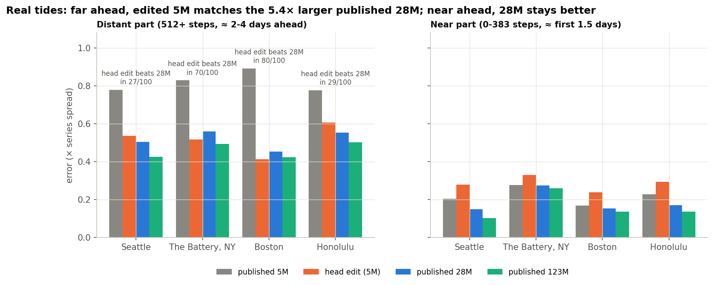

| Tide gauge | Distant error: published 5M | **Head edit (5M)** | Published 28M | Published 123M | Head edit beats 28M far ahead in |
| --- | --- | --- | --- | --- | --- |
| Seattle | 0.78 | 0.54 | **0.51** | 0.43 | 27 / 100 |
| The Battery, NY | 0.83 | **0.52** | 0.56 | 0.49 | 70 / 100 |
| Boston | 0.89 | **0.41** | 0.45 | 0.42 | 80 / 100 |
| Honolulu | 0.78 | 0.61 | **0.55** | 0.50 | 29 / 100 |

Errors in units of the series' spread; lower is better.

- **Far ahead, the edited 5M model is as good as the published 28M.** It beats 28M on two
  gauges (New York, Boston, where it even matches 123M). On the other two it closes 89 % and 77 %
  of the gap between the published 5M and 28M.
- **Near ahead, 28M stays clearly better** on every gauge, and the head edit's near-part cost widens
  that gap.

### 7. Only 32 works, and synthetic tests can't tell

We built the same edit for 12 distances, from 11 to 43 patches. On synthetic series almost
every distance from 28 to 43 repairs the dips equally well. On seven real hourly and daily
tasks, **every distance except 32 costs 44-65 % more error; 32 costs 1 %.**

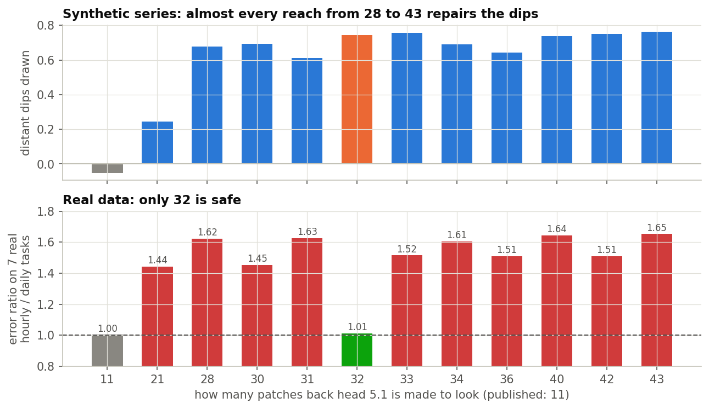

Two further tests narrow it down without fully explaining it. The safe distance does not
follow the block size used at forecast time (with blocks of 16 or 24 future patches, 32 is
still the only safe one), but 32 is the block size the model was **trained** with. And the
damage of other distances comes **through the future tokens**, not through how the history is
re-read.

### 8. An agent finds the faulty head with no hints

A fresh agent (Claude Code running Claude Opus 5.5) given only the symptom (no layer, no head, no hint) found the same head and the
same explanation in **32 model runs, about 10 minutes**, by recording which positions each
head reads and checking which ones follow the cycle. Its report:
[`agent_runs/run5_found_head_without_hints/REPORT.md`](agent_runs/run5_found_head_without_hints/REPORT.md).

### 9. The cost: short histories

The edited head needs 32 patches (1,024 steps) of history to reach. With about 1,000-1,500
steps of history, near-term patterns get worse than with the published model. Every fix we
tried shares this cost; the full fine-tune pays the most.

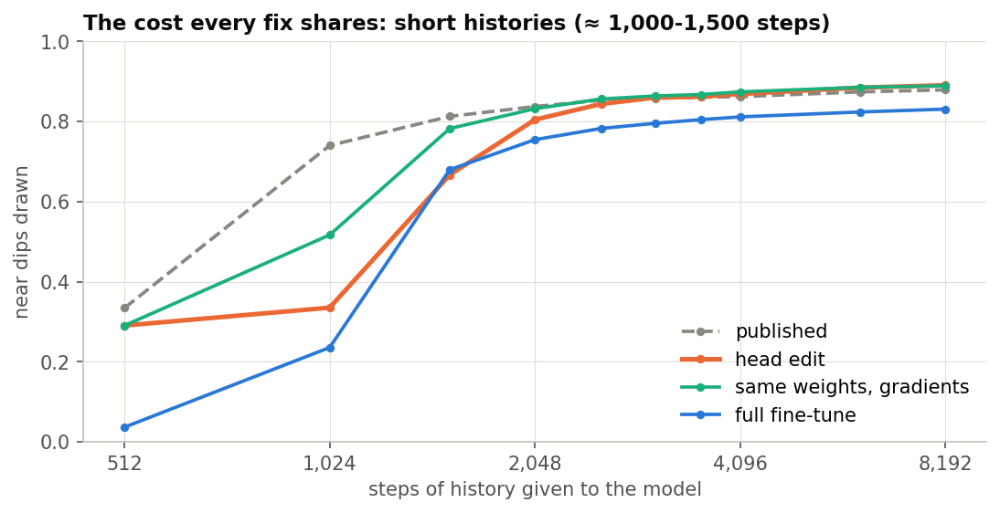

### 10. The failure shrinks with model size

With 8,192 steps of history, the published models draw
1 % (5M), 34 % (28M), 80 % (123M) and 96 % (209M) of each distant dip; the head edit brings 5M to
82 %. This study repairs the 5M model only.

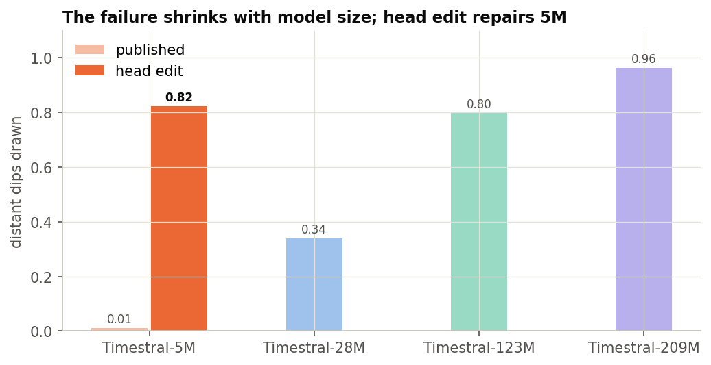

---

## What it means

- **A real failure of a published model can be located and repaired by reading its weights.**
  The fix is a mechanism, not a statistical patch: one head was pointing at the wrong place,
  and pointing it at the right place restores what the later heads already know how to do.
- **The location is what makes a fix safe.** Gradient training of the same 6,144 weights is
  as safe as the hand edit; the same training on all weights damages the model. The agent's
  main contribution is finding *where*; its choice of values then gets the most out of it.
- **Synthetic checks are not enough.** Distances that look equally good on synthetic series
  differ by 60 % on real data. Any weight edit, by hand or by agent, needs an unseen real
  benchmark before it can be trusted.
- **Editing repairs; it does not add.** The 5M model already had the pattern-copying heads; the
  edit only reconnects them. Larger models have the failure much less (finding 10), so there
  is less to repair there.

## How we found the head

We looked inside the model while it forecast, with four standard techniques.

**Where does each head look?** For every head, we recorded which past positions it reads, over
many series. A few heads always look at the same distance whatever the data; head 5.1 puts 91 %
of its attention exactly 11 patches back.

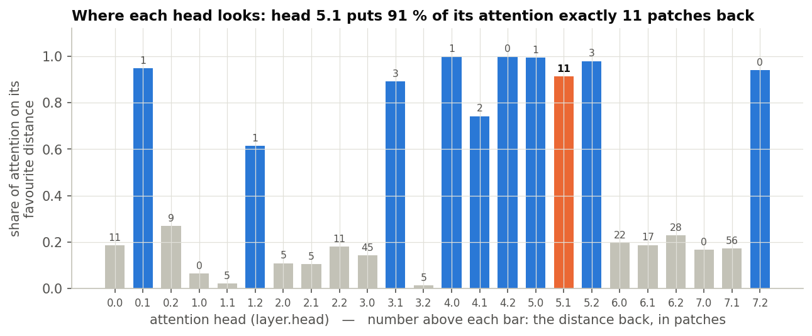

**Which heads follow the cycle, and where do they lose it?** For each future patch, we
measured whether a head reads history at the same point of the cycle (1 = chance, 9 = always).
Heads 5.1, 6.1, 6.2, 7.0, 7.1 and 7.2 lock onto the cycle near the start of the forecast; those
of layers 6 and 7 lose it between future patches 12 and 18, where the dips disappear.

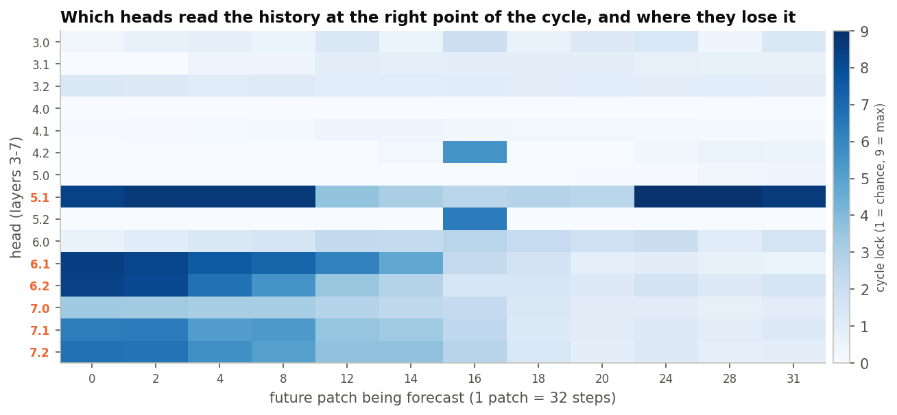

**Switching heads off, and swapping internal states.** Removing head 5.1 alone drops the near
dips drawn from 95 % to 43 % of each dip, far more than any other single head. Then, for far
future patches, we replaced their internal state with that of a nearer patch at the same point
of the cycle, starting at a chosen layer (*activation patching*). From layer 6 on, the far
dips come back (70 % of each dip, against 71 % when the whole state is swapped); from layer 5
or earlier, they don't. The information is lost
in layer 5, and layers 6-7 work when given the right input.

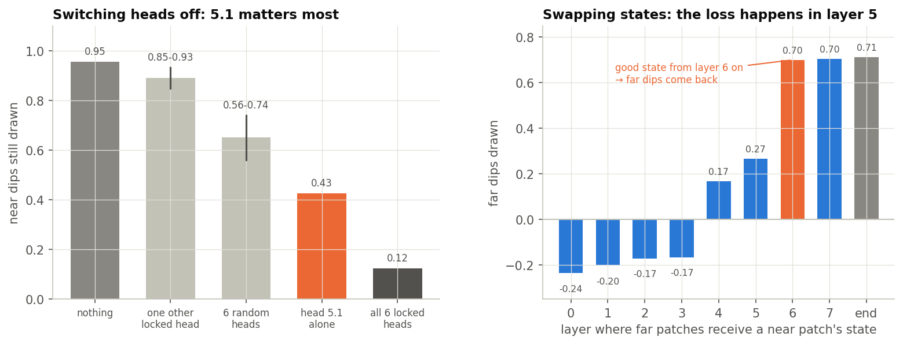

**Proof by forcing.** If head 5.1 is really the cause, forcing it to read a different
distance should switch the failure on and off. The editing agent did exactly that: during the
forecast, it overrode head 5.1's attention so that every token read one exact distance back,
then measured the distant dips (the dip score defined above, on series with a dip every 80 or
every 180 steps):

| Head 5.1 made to read… | Distant dips drawn, 80-step cycle | Distant dips drawn, 180-step cycle | What it shows |
| --- | --- | --- | --- |
| nothing changed (published model) | **−25 %** (dips drawn at the wrong place) | **−3 %** (no dip) | the failure |
| exactly 11 patches back (its own habit, made exact) | same as published | same as published | the head's distance alone reproduces the failure |
| **exactly 32 patches back** | **68 %** of each dip | **91 %** of each dip | changing only this distance removes the failure |

This intervention is a diagnostic, not the edit: it overrides the attention at run time. The
edit (below) then gets the same behaviour by changing the weights. (Forced runs scored on the
series only, without their mirror images; source:
[`agent_runs/run2_edit_b/journal.md`](agent_runs/run2_edit_b/journal.md), step 5.)

**The edit itself.** The model encodes position with rotary embeddings, so a head's preferred
distance is set by the phase of its query at each of 16 rotation frequencies. The agent
(Claude Code with Claude Fable 5.2, 51 of its 200 model runs) rotated and rescaled those
frequency pairs in the query of head 5.1, tensor `transformer.layers.5.attns.0.wQKV.weight`,
so the head's score peaks at 32 patches back for future tokens while tokens with 11-31 patches
of history keep reading 11 back. The design is traced step by step in its
[journal](agent_runs/run2_edit_b/journal.md). The hint-free agent of finding 8 ran on Claude
Opus 5.5; its own final edit used a different distance, and the edit reported here is the
head edit from the Fable 5.2 run.

**The model, for reference.**

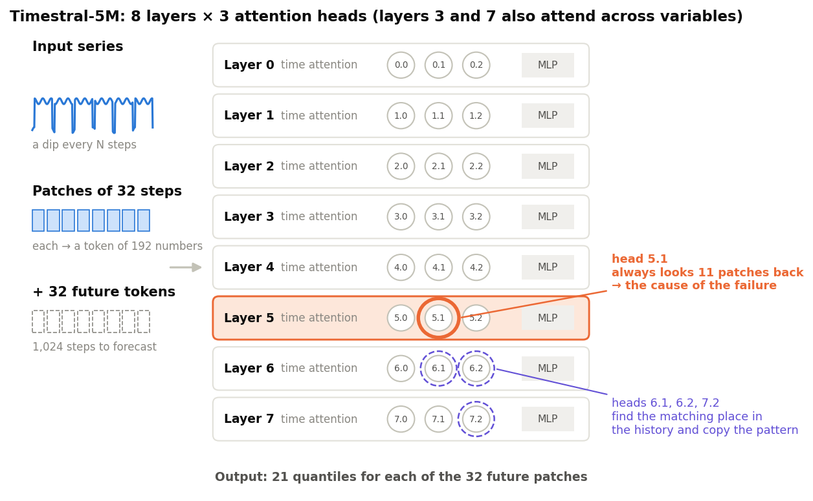

## Limits

- One model family and one failure.
- The fine-tuning comparison uses our own training recipe; Mistral's is not published.
- Near-term forecasts get worse when the history is short (finding 9).
- Why 33 already hurts long hourly series is not explained.
- Forecasting in smaller blocks (an existing setting, no weight change) cuts the error of the
  central forecast a little more (1 % less on the benchmark, against none for the head edit) but makes
  the uncertainty ranges worse (CRPS, which scores the whole range of likely values the model
  gives, 1.3 % worse, and more than 5 % worse on 13 tasks). The head edit is the only fix we found that
  leaves both intact.
- The proper fix potentially belongs in training, which only Mistral can change.
- Reproducibility: an agent run is not deterministic, so rerunning the experiment may not
  give the same edit or the same results. The saved head edit (`edit/edit_b_patch.safetensors`)
  reproduces the reported model exactly.

## How to run

### Setup

Run on Windows with Python 3.12, torch 2.6.0 (CUDA 12.4), numpy 1.26.4 and `uv`; the commands
below are the same steps written for any platform.

```bash
python -m venv .venv
.venv/bin/pip install torch "git+https://github.com/mistralai/timestral.git" safetensors pandas matplotlib
# for the benchmark scripts:
git clone https://github.com/SalesforceAIResearch/gift-eval.git external/gift-eval
.venv/bin/pip install "gluonts~=0.15.1" "numpy~=1.26.0" "datasets~=2.17.1" "scipy~=1.11.3" "pyarrow>=15,<17" toolz python-dotenv
.venv/bin/pip install --no-deps -e external/gift-eval
python -c "from huggingface_hub import snapshot_download; snapshot_download('Salesforce/GiftEval', repo_type='dataset', local_dir='data/gifteval')"
```

### Use the edited model

```bash
python edit/apply_edit_b.py          # writes checkpoints/edit_b/ from the published weights + the patch
```

```python
from timestral import TimestralForecaster
fc = TimestralForecaster.from_pretrained("checkpoints/edit_b")
```

### Where each result comes from

| Result | Script | Stored output |
| --- | --- | --- |
| Lead-time limit (finding 1) | `experiments/gap_10s/check3_synthetic_lead_time.py` | `results/gap_10s/check3_synthetic.csv` |
| Head distances | `experiments/edit_5m/check_28m_fixed_lag.py` via `experiments/scale/failure_by_size.py` | `results/scale/lag_heads_by_size.csv` |
| Cycle lock | `experiments/gap_10s/check5_attention_lock.py` | `results/gap_10s/check5_attention_lock.csv` |
| Switching off, swapping | `experiments/gap_10s/check6_cause_and_uncertainty.py`, `check7_where_it_breaks.py` | `results/gap_10s/check6.log`, `check7_patching_cycle80.csv` |
| Head edit vs fine-tunes (finding 4) | `experiments/edit_5m/heldback_finetune_vs_b.py`, `heldback_sameweights.py`, `baseline_finetune.py`, `finetune_same_weights.py` | `results/edit_5m/finetune_vs_b/`, `sameweights_vs_b/` |
| Benchmark (finding 5) | `evaluation/gift_eval_run.py --checkpoint … --compare-with Timestral-5M` | `results/gift_eval/*/against_published.csv` |
| Example forecast (top figure); best-case real window; real-data error by distance | `analysis/make_examples.py` | `results/examples.npz` |
| Near vs distant on real data (finding 5) | `analysis/far_horizon_real.py` | `results/far_horizon_real.csv` |
| Tides, solar radiation, taxi demand, outside the benchmark, with published 28M and 123M (finding 6) | `analysis/external_real.py` (downloads the public data) | `results/external_real.npz`, `results/external_real_summary.csv` |
| Distance sweep (finding 7) | `experiments/edit_5m/lag_sweep.py`, `tools/lag_sweep.ps1`, `analysis/lag_sweep_summary.py` | `results/lag_sweep_gift.csv`, `results/edit_5m/lag_sweep_synthetic.csv` |
| Block size, history vs future | `experiments/edit_5m/block_size_test.py`, `split_history_future.py` | `results/block_size_test.csv`, `results/edit_5m/split_history_future.csv` |
| Short-history cost (finding 9) | the held-back scripts above | `results/edit_5m/*/history_length.csv` |
| Model sizes (finding 10) | `experiments/scale/failure_by_size.py` | `results/scale/failure_by_size.csv` |
| All figures | `make_figures.py` (no model runs) | `figures/` |

The scripts ran on one laptop GPU (8 GB). `results/` holds their outputs, and
`make_figures.py` redraws every figure from them.

```
edit/            the patch, the script that applies it, the reference means used by the sweep
agent_runs/      task, journal and scripts of the run that produced the head edit, and of the run
                 that found the head without hints
experiments/     failure, cause, comparisons, sweep, sizes
evaluation/      GIFT-Eval runner
analysis/        analyses of stored results
results/         stored outputs
figures/         README figures
```

## Acknowledgements

- [Timestral](https://github.com/mistralai/timestral) by Mistral AI.
- [GIFT-Eval](https://github.com/SalesforceAIResearch/gift-eval) benchmark.
- The weight-space programming idea and protocol:
  [*Sparks of Weight-Space Programming*](https://rikiyat.github.io/blog/weight-space-programming/).
- Experiments run with Claude Code; the editing agents are Claude models (Anthropic).
